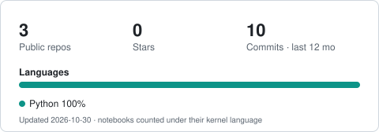

<!-- BANNER — profile.sh --live. Generated by scripts/banner/generate.py -->
<picture>
  <source media="(prefers-color-scheme: dark)"  srcset="assets/banner-dark.svg">
  <source media="(prefers-color-scheme: light)" srcset="assets/banner-light.svg">
  
</picture>

 

 

&nbsp;&nbsp;
&nbsp;&nbsp;

---

## This is me

Hi, I'm **Mauricio**, a 3rd-year **Business Intelligence & Data Analytics** student at La Salle – Universitat Ramon Llull, based in Barcelona.
I turn raw data into decisions: clean pipelines underneath, clear visuals on top.

- 🎓 **BI & Data Analytics @ La Salle URL**, graduating June 2028.
- 🏗️ Building **medallion pipelines** (bronze → silver → gold) with **SQL, DuckDB and Databricks**.
- 📊 Analysis and ML with **pandas, scikit-learn and ARIMA**; dashboards in **Power BI**; plots with **ggplot2 and seaborn**.
- 🤖 Experimenting with **local LLM pipelines**: vision → text → speech, fully offline.
- 📜 **IBM Data Analyst** · **Google Data Analytics Specialization**.
- 🌍 Spanish (native) · English (C2) · Catalan (C1).
- 💬 Looking for **Data Analytics / BI internships**. Talk to me about pipelines or dashboards and you'll have my full attention.

 

## my stack

  

<code></code>&nbsp;
<code></code>&nbsp;
<code></code>&nbsp;
<code></code>&nbsp;
<code></code>&nbsp;
<code></code>

## featured work

| Project | What it does |
|:--|:--|
| 🎙️ **[local-ai-video-analysis-pipeline](https://github.com/datamauriciovaldez/local-ai-video-analysis-pipeline)** | Football footage → frames → captions → script → voice, with 100% local inference. `Python` `polars` `Gemma` `Qwen` `OmniVoice` |
| 📈 **[sales-performance-eda](https://github.com/datamauriciovaldez/sales-performance-eda)** | 9,994 retail order lines: Technology earns ~9× the profit per line of Furniture. `pandas` `seaborn` |
| 🏗️ **barcelona-data-pipeline** · *coming soon* | Medallion pipeline over Barcelona municipal open data. `SQL` `Databricks` |
| 🚀 **venture-capital-ml** · *coming soon* | Predicting startup success to support VC investment decisions. `Python` `scikit-learn` |

 

<picture>
  <source media="(prefers-color-scheme: dark)" srcset="assets/github-stats-dark.svg">
  
</picture>

---

Barcelona · <a href="https://www.linkedin.com/in/mauricio-valdezf">linkedin.com/in/mauricio-valdezf</a>

